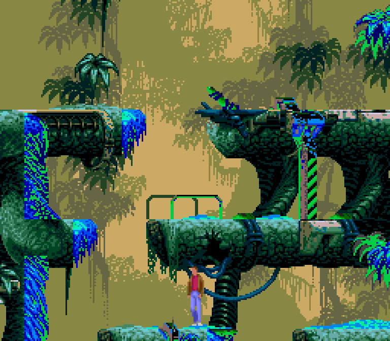
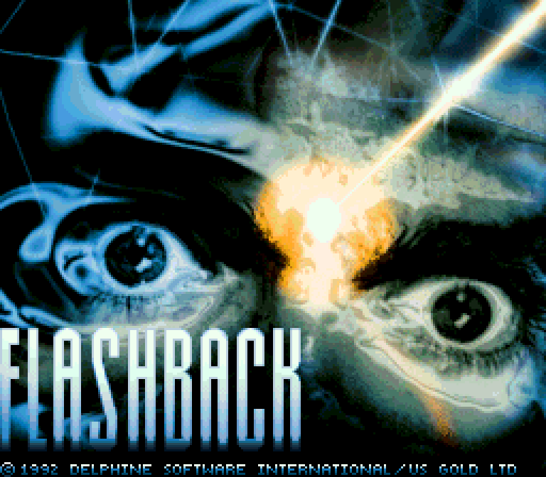
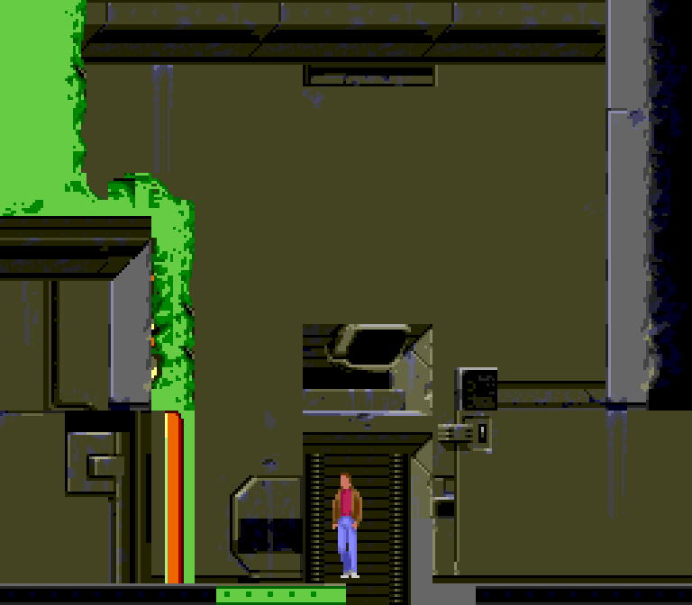
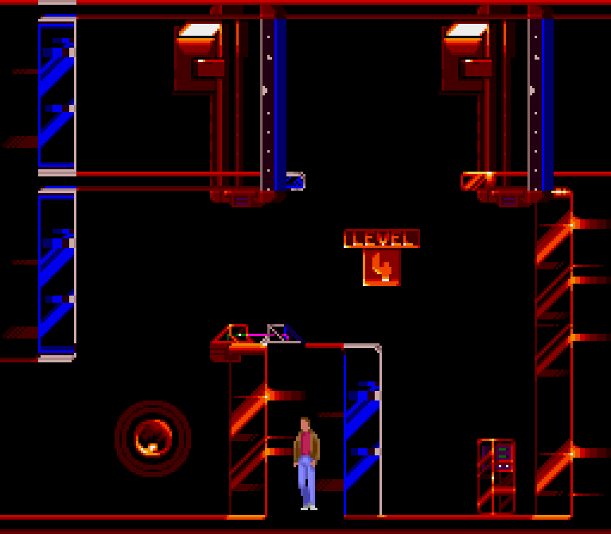
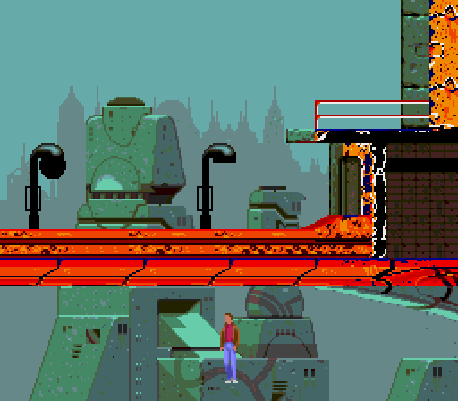
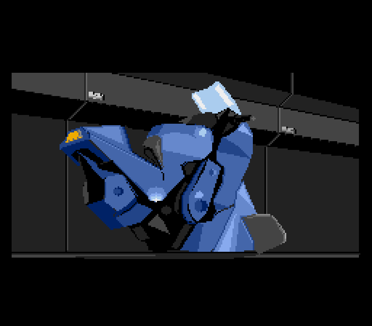
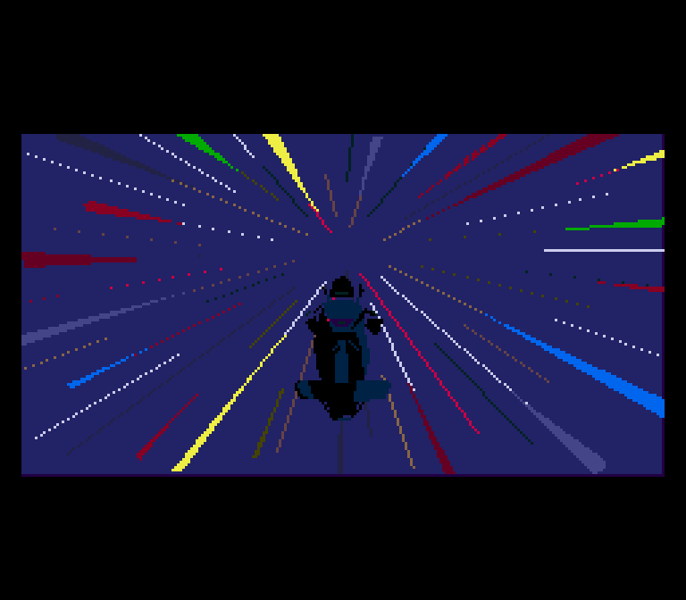

# OpenFlashback

[](https://github.com/dagrigorev/OpenFlashback/actions/workflows/ci.yml)
[](https://github.com/dagrigorev/OpenFlashback/actions/workflows/release.yml)
[](https://github.com/dagrigorev/OpenFlashback/releases/latest)
[](https://github.com/dagrigorev/OpenFlashback/wiki)
[](https://dagrigorev.github.io/OpenFlashback/)

**[Download](https://github.com/dagrigorev/OpenFlashback/releases/latest)** ·
**[Wiki](https://github.com/dagrigorev/OpenFlashback/wiki)** ·
**[Installation](https://github.com/dagrigorev/OpenFlashback/wiki/Installation)** ·
**[File Formats](https://github.com/dagrigorev/OpenFlashback/wiki/File-Formats)** ·
**[API docs](https://dagrigorev.github.io/OpenFlashback/)**



An open-source engine, written from scratch in Rust, that will play **Flashback (1992)** on modern
Windows, Linux and macOS computers using the data files from **your own copy** of the DOS game.

OpenFlashback contains **no** Flashback game content (levels, graphics, sounds, music, executables).
Without the original files it does nothing. Flashback is © 1992 Delphine Software International.

Sister project of [OpenBlood](https://github.com/dagrigorev/OpenBlood), built the same way.

## What works

Early days: the original data is read and drawn, and Conrad moves with his original animations,
but there are no level scripts, enemies or items yet.

- Clean-room readers for: the title and instruction screens (`menuN.map` / `.pal`, planar
  256 x 224), level backgrounds (`levelN.map`, 64 rooms of four run-length packed bands, with the
  level's 12-bit `levelN.pal` palettes), Delphine's "bytekiller" compression with checksum, the room
  connection table and collision grid (`levelN.ct`), character sprite banks (`perso.spr` /
  `.off`, 4-bit run-length frames with their anchor points), animation tables (`.ani`) and the
  objects' starting state (`.pge`), and the object scripts (`.obj`: per-state transition lists).
  Conrad's colours are read from your `FB.EXE`.
- Cutscenes: the polygon pictures (`.pol`) and their scripts (`.cmd`) are played in the
  original's 240 x 128 letterbox. The publishers' logos play at startup, the intro (escape and
  crash on Titan) when a new game starts; any key skips. Captions and in-picture text use the
  game's own font (`fb_txt.fnt`) and texts (`fr_cine.txt`).
- Each level starts where the original does (level 1: Conrad waking up in the jungle). Conrad
  turns, walks, runs, jumps (standing and running), crouches, falls, climbs up onto ledges and
  down from them, with the original animations and the animation chains of the original script;
  every move covers whole 16-pixel cells of the room grid.

Not yet: running the object scripts themselves (most of their condition and action opcodes are
still unknown), enemies, items,
shooting, text, sound and music. The game and cutscene speeds are estimates (30 updates and 12
cutscene frames per second) until they are measured against the original.

| | |
| --- | --- |
|  |  |
|  |  |
|  |  |

## Setup

1. Copy every file from the `DATA` folder of your installed DOS Flashback next to
   `openflashback.exe` (or pass `--data <dir>`), and `FB.EXE` too for Conrad's colours.
2. Run `openflashback.exe` (fullscreen by default).

Command line: `--windowed`, `--data <dir>`, `--level N` (1-5, skips the title), `--room N`.

## Controls

| Action | Keys |
| --- | --- |
| Skip a cutscene | any key |
| Start a new game (title screen) | Enter / Space |
| Walk (turn first when facing away) | Left / Right (A / D) |
| Run | Shift + Left / Right |
| Jump forward (running jump when running) | Up + Left / Right |
| Jump up, or climb onto the ledge above | Up (W) |
| Crouch (while held) | Down (S) |
| Climb down from a ledge edge | Shift + Down |
| Jump to level 1-5 | 1 - 5 |
| Previous / next room | `[` / `]` |
| Fullscreen | F11 |
| Back to title / quit | Esc |

## Building

```
cargo build --release
cargo test
OPENFLASHBACK_DATA=path/to/flashback cargo test --release   # + tests against your original files
```

Crates: `of-engine` (data formats), `of-game` (game state), `openflashback` (window, input, tools).

Developer tools (`openflashback <tool> ...`): `screen` (title/instruction picture to PNG), `rooms`
(contact sheet of a level), `shot` (one room with Conrad), `sprites` (sprite bank sheet), `ct`
(room connections), `film` (play scripted input and save a contact sheet of frames), `obj` (print
an object's script transitions), `cutscene` (play a cutscene into a contact sheet).

## Releases and CI

Every push to `master` builds and tests Windows (x64, ARM64), Linux and macOS (universal)
packages; a maintainer approves the build before it is published as a GitHub release, and the
wiki's [Releases](https://github.com/dagrigorev/OpenFlashback/wiki/Releases) page updates itself.
Pull requests run formatting, lint, test and rustdoc checks. Details:
[CI and Releases](https://github.com/dagrigorev/OpenFlashback/wiki/CI-and-Releases).

The wiki is generated from the [`wiki/`](wiki) folder; edit pages there.

## License

MIT (see `LICENSE-MIT`). Format knowledge comes from public documentation and from inspecting
the user's own files; no original or decompiled source code was used.
