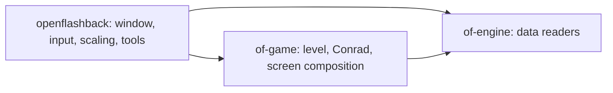

# Architecture

A Cargo workspace of three crates:

| Crate | Path | Contents |
| --- | --- | --- |
| `of-engine` | `crates/engine` | `data` (case-insensitive data directory), `unpack` (bytekiller), `palette`, `screen` (bitmaps, planar pictures), `level` (rooms, connection table), `sprite` (character banks) |
| `of-game` | `crates/game` | `Game`: loads a level, moves Conrad, composes the 256 x 224 indexed screen and its palette |
| `openflashback` | `crates/openflashback` | `app` (winit window, softbuffer presentation scaled to 4:3, fixed 60 Hz ticks), `tools` (PNG dumps) |

The screen is 256 x 224 pixels with 256 palette entries: `0x00-0x0f` room background,
`0x40-0x4f` Conrad, `0x80-0x8f` room foreground.
